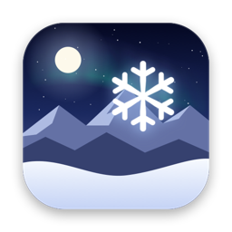
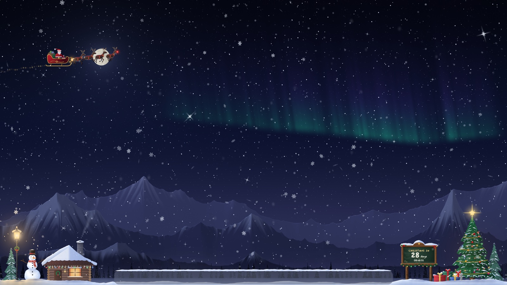
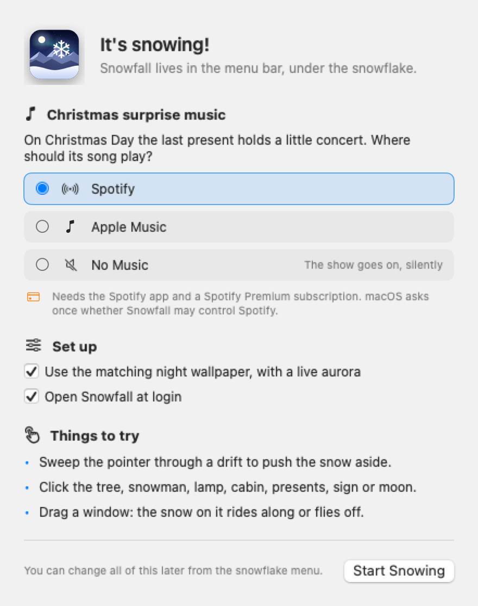
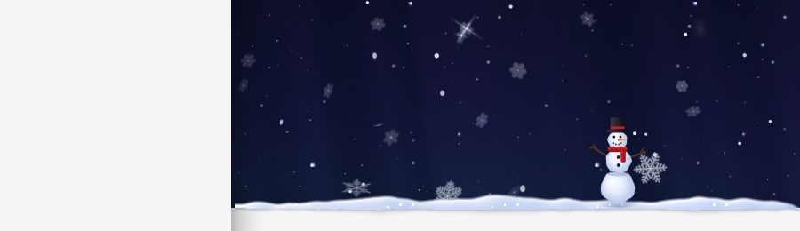

<p align="center">
  
</p>

<h1 align="center">Snowfall</h1>

<p align="center">
  Snow on your Mac desktop. It piles up on your windows and the Dock, slides off roofs,<br>
  and gets pushed around by your pointer. A small native menu bar app, free.
</p>



## Install

Requires macOS 13 Ventura or later (Apple silicon or Intel).

### Option 1: one line in Terminal (easiest)

Open **Terminal** (⌘ Space, type "Terminal"), paste this and press Return:

```bash
curl -fsSL https://raw.githubusercontent.com/heonrim/snowfall-releases/main/install.sh | bash
```

It downloads the latest Snowfall, puts it in Applications and starts it. Run the same line again any time to update.

### Option 2: download the disk image

1. Download **[Snowfall.dmg](https://github.com/heonrim/snowfall-releases/releases/latest/download/Snowfall.dmg)**, open it and drag **Snowfall** onto **Applications**.
2. Open Snowfall from Applications. macOS will say it can't verify the developer, because Snowfall is a free app that isn't notarized by Apple. Click **Done** (or **OK**).
3. Open **System Settings → Privacy & Security**, scroll down and click **Open Anyway** next to Snowfall, then confirm.

You only need to do this once.

A snowflake ❄ appears in the menu bar. Everything is controlled from there.

### First launch

A short setup asks where the Christmas surprise song should play: **Spotify**, **Apple Music** or **no music**.

- Either service needs its app and a **subscription** (Spotify Premium, or Apple Music).
- macOS asks once whether Snowfall may control that app.
- Apple Music only lets other apps play songs that are in your library, so the setup has a button that opens the song in Music: click **+** to add it.

You can change this later under **Christmas Music** in the snowflake menu, or open **Setup…** again.

<p align="center"></p>

## 安裝（中文）

需要 macOS 13 以上。

**最簡單：** 打開「終端機」（⌘ 空白鍵，輸入「終端機」），貼上這行後按 Return：

```bash
curl -fsSL https://raw.githubusercontent.com/heonrim/snowfall-releases/main/install.sh | bash
```

會自動下載最新版、放進「應用程式」並打開。之後要更新，再跑一次同一行就好。

**或用 DMG：** 下載 [Snowfall.dmg](https://github.com/heonrim/snowfall-releases/releases/latest/download/Snowfall.dmg)，把 Snowfall 拖進 Applications。第一次打開時 macOS 會說無法驗證開發者（因為這是沒付費給 Apple 公證的免費 App），按「完成」，再到「系統設定 → 隱私權與安全性」往下捲，按 Snowfall 旁邊的「強制打開」即可，只需一次。

**第一次打開：** 會先請你選擇聖誕驚喜歌曲要用哪裡播放：**Spotify**、**Apple Music** 或**不播放音樂**。
- 兩種都需要安裝對應的 App，並且**有訂閱**（Spotify Premium 或 Apple Music）。
- macOS 會問一次是否允許 Snowfall 控制該 App。
- Apple Music 只允許其他 App 播放「資料庫」裡的歌曲，所以設定畫面有按鈕可以在「音樂」App 打開這首歌，按 **+** 加入資料庫即可。

之後可以在選單列雪花的 **Christmas Music** 更改，或重新打開 **Setup…**。

## What's inside

- Snow in three layers with wind, piling up on the ground, on top of windows and on the Dock. Drag a window and it stirs up the snow around it.
- A cozy winter scene along the bottom of the screen: cabin, snowman, street lamp, Christmas tree and presents. Click things; most of them answer back.
- Little snowmen get built on windows that have gathered enough snow.
- A chalkboard countdown to Christmas, and four presents to open on Christmas Day, full of surprises (balloons, a toy train, a snowball fight, fireworks that write in the sky…), with the best one saved for last (and maybe a peek before, if you knock).
- Light on battery: 30 fps when idle, pauses behind full-screen apps, honors Low Power Mode and Reduce Motion.

| | |
|---|---|
|  |  |



## Permissions

Snowfall needs **no permissions**. It reads window positions (never their contents) so snow can land on them. If you choose Spotify or Apple Music for the Christmas song, macOS asks once whether Snowfall may control that app; saying no only keeps the show silent. Snowfall makes no network connections and collects nothing.

## Uninstall

Choose **Quit Snowfall** from the snowflake menu, then delete it:

```bash
rm -rf /Applications/Snowfall.app
defaults delete io.github.heonrim.snowfall
```

## Trademarks

Spotify and Apple Music are trademarks of their owners; Snowfall is not affiliated with or endorsed by them. Snowfall includes no music: the song plays in your own Spotify or Music app, through your own subscription.

## License

MIT. This repository only hosts the installers.
